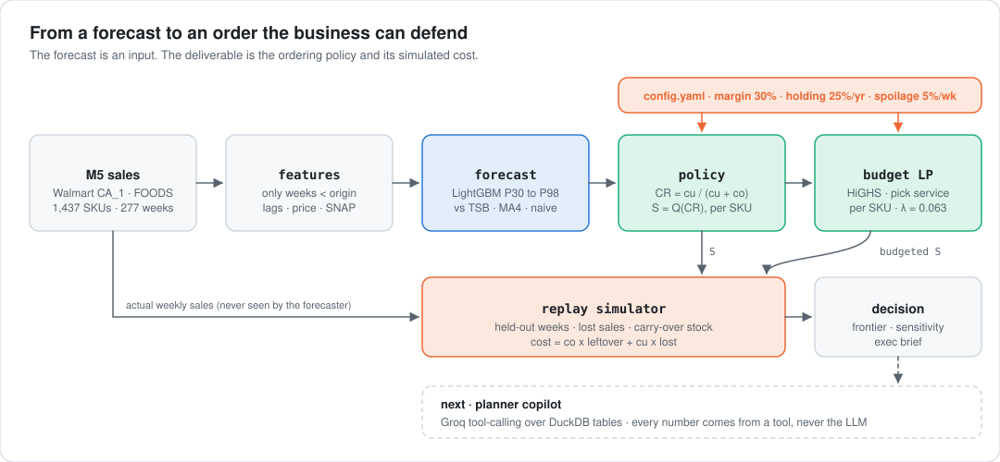
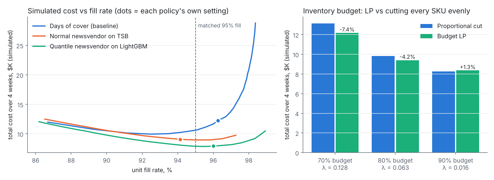

<div align="center">

# Forecast-to-Order Copilot

**Turns quantile demand forecasts into cost-optimal, budget-constrained ordering decisions.**
<br>A prescriptive analytics engagement on 1,437 Walmart grocery SKUs from the public M5 dataset.

[](https://github.com/Jitesh-Mishra/forecast-to-order-copilot/actions/workflows/ci.yml)


-0054a6?logo=scipy&logoColor=white)


| **−25.7%** | **−15.8%** | **−6.2%** | **λ = $0.063** |
|:---:|:---:|:---:|:---:|
| simulated cost vs days-of-cover at matched 95% fill | inventory dollars at the same fill | forecast error (MASE) vs best baseline | expected cost saved per extra budget dollar at 80% budget |

</div>

> All dollar figures are **simulated**. M5 has sales and prices but no costs, margins, lead times or inventory, so the economics are stated assumptions in [`config.yaml`](config.yaml), and the sensitivity table below shows the conclusion holds across 9 cost scenarios. These are public M5 data; the project has no Walmart affiliation.

---

## 1. The client question

*"We order every SKU up to two weeks of recent average sales. Is that costing us money? And if finance cuts the inventory budget, where should the cut land?"*

Days-of-cover is how many grocery teams actually order. It is simple and explainable, but it treats a steady seller and a sporadic one the same way, and it ignores what a stockout costs compared with a unit that spoils. This engagement replaces the rule with a decision derived from each SKU's demand distribution and economics. It then replays four held-out weeks of real sales to price the difference.

## 2. How the decision is made

<picture>
  <source media="(prefers-color-scheme: dark)" srcset="docs/img/pipeline-dark.svg">
  
</picture>

1. **Forecast the distribution, not a point.** LightGBM predicts weekly demand quantiles (P30, P50, P70, P80, P90, P95, P98) for each SKU, re-forecast every week as actuals arrive.
2. **Price the trade-off.** A unit short loses its margin (`cu = 30% × price`). A unit left over costs holding plus spoilage (`co = cost × (25%/52 + 5%)`). The critical ratio `cu / (cu + co)` is about 0.89 for a typical SKU.
3. **Order up to that quantile.** `S = Q(CR)` per SKU per week. This is the classic newsvendor, fed by a learned distribution instead of a normal assumption.
4. **Respect the budget.** When stock dollars are capped, an LP (SciPy `linprog`, HiGHS) chooses each SKU's service level to minimise total expected cost. Its dual gives the **shadow price** of the budget.
5. **Replay.** Every policy runs against the real held-out sales with lost sales and carried-over stock, and is scored on cost, fill rate and stock dollars.

## 3. Findings

Locked test window: the last 4 weeks of M5 (d_1914 to d_1941). 1,436 SKUs, evaluated once (`reports/test_runs.json`). Two earlier 4-week backtests were used for every modelling decision.

### The recommendation beats the rule at every service level

<picture>
  <source media="(prefers-color-scheme: dark)" srcset="reports/figures/decision-dark.png">
  
</picture>

| Policy | Simulated cost (4 wks) | Fill rate | Avg stock $ | Cost at matched 95% fill | Stock $ at 95% fill |
|---|---:|---:|---:|---:|---:|
| Days of cover, 2 weeks of 4-wk avg (current rule) | $12,240 | 96.3% | $84.4K | $10,614 | $72.3K |
| Normal newsvendor on TSB (textbook upgrade) | $9,062 | 94.1% | $62.5K | $8,974 | $65.4K |
| **Quantile newsvendor on LightGBM** (recommended) | **$7,919** | 96.0% | **$64.7K** | **$7,891** (−25.7% / −12.1%) | **$60.9K** (−15.8% / −6.9%) |

- **Same service, less cost and less stock.** At its own cost-based setting, the recommended policy matches the current rule's fill rate (96.0% vs 96.3%) with 35% lower simulated cost and 23% less inventory.
- **The win is not just "order less".** At *every* matched fill rate from 90% to 97%, its cost curve sits below both baselines. The days-of-cover curve explodes above 96% because it buys service by over-stocking everything.
- **Where the distribution matters most.** Against the normal-assumption newsvendor, the gain is only 5% on smooth SKUs. It is 22% on intermittent, 16% on lumpy and 27% on erratic ones, exactly where a symmetric normal is the wrong shape.

### Under a budget cut, the LP decides where to cut

| Inventory budget | Proportional cut (every SKU scaled evenly) | Budget LP | LP vs proportional | Shadow price λ |
|---|---:|---:|---:|---:|
| 70% | $13,151 | **$12,181** | **−7.4%** | $0.128 |
| 80% | $9,818 | **$9,408** | **−4.2%** | $0.063 |
| 90% | $8,258 | $8,365 | +1.3% | $0.016 |

Both plans spend the same budget. The LP protects high-margin, predictable SKUs and drops stock where the expected loss is smallest. **λ is the number finance needs.** At 80% budget, each extra dollar of inventory saves about 6 cents of expected weekly cost. That is a direct way to price the cut. At 90% the LP loses slightly: it optimises *expected* cost under the forecast, so when the forecast's tails are off (P90 covers 87%, not 90%), its edge disappears once the budget barely binds. Both backtests showed the same pattern (−0.2% and −1.8% at 90%, −9% to −12% at 70%).

### The forecast is better, but that is not where the money is

| Model | MASE (mean) | vs LightGBM | Smooth | Intermittent | Lumpy |
|---|---:|---:|---:|---:|---:|
| Seasonal naive (52 wk) | 1.538 | +55.6% | 1.372 | 1.943 | 1.674 |
| Naive (last week) | 1.152 | +16.6% | 1.043 | 1.462 | 1.118 |
| 4-week average | 1.053 | +6.6% | 0.933 | 1.337 | 1.160 |
| TSB (statsforecast) | 1.050 | +6.3% | 0.920 | 1.341 | 1.218 |
| **LightGBM P50** | **0.988** | | **0.873** | **1.265** | **1.074** |

The quantile forecasts are reasonably calibrated: P90 covers 87.2% of weeks, versus 82.8% for TSB with normal intervals. A 6% MASE gain turns into a 12 to 26% cost gain because the **policy layer, not the point forecast, is where the value is**. A MASE winner isn't automatically the cost winner, which is why the policies are scored in dollars.

### Does it survive different economics?

| Margin | Spoilage /wk | Critical ratio | vs days-of-cover (2 wk) | vs days-of-cover (best k, chosen in hindsight) | vs normal newsvendor at 95% fill |
|---:|---:|---:|---:|---:|---:|
| 20% | 1% | 0.94 | −32.7% | −30.1% | −8.9% |
| 20% | 5% | 0.82 | −42.6% | −14.5% | −14.1% |
| 20% | 10% | 0.71 | −53.5% | −7.7% | −15.9% |
| 30% | 1% | 0.97 | −39.7% | −38.8% | −7.0% |
| **30%** | **5%** | **0.89** | **−35.3%** | **−20.4%** | **−12.1%** |
| 30% | 10% | 0.80 | −44.3% | −13.2% | −14.4% |
| 40% | 1% | 0.98 | −48.2% | −45.8% | −5.6% |
| 40% | 5% | 0.92 | −32.5% | −26.4% | −10.3% |
| 40% | 10% | 0.86 | −37.9% | −18.4% | −12.9% |

The recommendation wins in all 9 scenarios, including against a days-of-cover setting tuned on the test outcome itself. **The margin narrows when spoilage is high and margins are thin** (−7.7% at 20% margin and 10% spoilage). There a simple rule tuned per category gets close, and the case for the model rests on its per-SKU adaptivity rather than raw savings. Full table: `reports/sensitivity_test.csv`.

## 4. Risks and what would change the answer

- **The economics are assumed.** Real margins, spoilage by department and case-pack rounding would move the dollar figures. The sensitivity table shows the direction is robust, not the magnitude.
- **Sales are not demand.** M5 records sales, so stockout weeks understate true demand, and every policy is scored on censored demand.
- **Lead time is fixed at one week** with weekly review. Longer or variable lead times need a protection-period distribution (next step).
- **The LP is myopic.** It plans one week at a time and ignores stock already on hand above the target. That's acceptable for a fast-moving grocery category, but it is the first thing to fix for slow movers.
- **One store, one category, four test weeks.** The two backtests agree with the test on direction and rough size (`reports/*_backtest.csv`).

## 5. Next steps

1. **Planner copilot:** Groq tool-calling over DuckDB with `get_sku_plan`, `compare_policies`, `what_if_budget` (re-solves the LP) and `explain_cost_drivers`. The LLM never writes a number, and overrides above a threshold need human approval. It will be evaluated on 50 code-computed gold questions against a no-tools baseline.
2. **Streamlit app** with the frontier, an SKU drill-down and the copilot. Then lead-time sensitivity, conformal recalibration of the upper quantiles, and per-department margins.

The one-page version for a VP of Supply Chain is [`docs/exec_brief.md`](docs/exec_brief.md).

## Reproduce

```bash
pip install -r requirements.txt
export PYTHONPATH=src
python -m f2o.run --folds backtest      # 2 backtest folds: all tuning decisions (about 4 min, 2 CPUs)
python -m f2o.run --folds test          # the locked test weeks, run once (about 3 min)
python scripts/make_figures.py && python scripts/make_diagrams.py
pytest -q                               # simulator accounting, LP vs brute force, no-peek features
```

`data/` holds the CA_1 FOODS extract of M5 (3.3 MB parquet). To rebuild it, download the M5 Forecasting Accuracy CSVs and run `scripts/prepare_data.py`.

<details>
<summary><b>Method details</b></summary>

- **Weeks:** Monday to Sunday buckets starting at d_3, so the last 4 weeks are exactly the M5 evaluation window. Prices are averaged across the week from Walmart's `wm_yr_wk` prices.
- **Folds:** backtests on weeks 265 to 268 and 269 to 272. Test on weeks 273 to 276. LightGBM trains on targets before `origin − 8` and early-stops on the 8 weeks before the origin.
- **Features (as of origin):** lags 1/2/3/4/8, the same week last year, rolling means over 4/8/13/26/52 weeks, 13-week std, zero share and non-zero mean, weeks since last sale, age, target-week price and price ratios (prices are planned, so they are known in advance), SNAP days, events, month, week of year, department and item. A unit test scrambles all future weeks and asserts that no feature moves.
- **Quantiles:** one LightGBM per level, sorted to prevent crossing, clipped at 0. The forecast distribution between quantiles is piecewise linear, used for expected-cost integrals.
- **Policy simulation:** lost sales, excess stock carried forward (never returned), overage cost charged on stock left at week end. Fill rate is units sold divided by units demanded.
- **Budget LP:** for each SKU, the options are S = 0 or S = ceil(Q(α)) for each α in the quantile set. It is a multiple-choice knapsack LP relaxation (at most one fractional SKU, rounded down), and a unit test checks it against brute force. The budget is a fraction of the unconstrained optimal plan's stock value. The proportional baseline scales every SKU by one factor that spends the same budget.
- **Decisions and why:** [`docs/decisions.md`](docs/decisions.md). Every run: [`reports/experiments.csv`](reports/experiments.csv).
</details>

---

<sub>**Stack:** Python, pandas, LightGBM, statsforecast, SciPy (linprog, HiGHS), DuckDB, Groq, Streamlit, pytest · predictive models, prescriptive models, evaluation, end-to-end, visualizations. DuckDB, Groq and Streamlit arrive with the copilot milestone. Data: M5 Forecasting Accuracy (public).</sub>
